<div align="center">

```
 ___________________________________________________________________________________________________
|                                                                                                   |
|  ROM BIOS (C)1995-1999 INDIEDEV CORP. // ALL RIGHTS RESERVED // ALLIANCE MODULAR V4.51PG          |
|  PENTIUM-PRO @ 200MHz // 65,536 KB SYSTEM RAM PASSED // 512KB PIPELINE BURST CACHE // L1+L2 OK    |
|  PRIMARY MASTER: QUANTUM FIREBALL 4.3GB // PRIMARY SLAVE: CD-ROM 48X MAX // ATAPI OK             |
|  INITIALIZING VESA 2.0 1024x768x16M // SOUND BLASTER 16 ON IRQ5, DMA1, PORT 220H                  |
|  DIAL-UP CARRIER DETECTED: 57,600 BPS // PROTOCOL: V.90 / K56FLEX // CARRIER ONLINE              |
|___________________________________________________________________________________________________|
```

<!-- 90S RETRO BUTTON STRIP & ODOMETER -->


<br/>

<!-- ANIMATED CYBERDECK BOOT HEADER -->


<a href="https://github.com/utkarshIsAProgrammer">
  
</a>

<br/>

<!-- RETRO BBS MODEM UPLINK BADGES -->
<a href="https://www.linkedin.com/in/utkarsh-yadav-62b974374/"></a>
<a href="https://x.com/indieDev_ut"></a>
<a href="https://www.instagram.com/panchajanya_utkarsh/"></a>
<a href="https://www.reddit.com/user/panch_ajanya"></a>
<a href="mailto:utkarshprogrammer2005@gmail.com"></a>
<br/>


</div>

---

<!-- ───────────── ABOUT ───────────── -->


```text
 ╔═════════════════════════════════════════════════════════════════════════════════════════════════════╗
 ║  MS-DOS 6.22 EDIT.COM — [ C:\SYSOP\IDENTITY.NFO ]                                            [■]    ║
 ╠═════════════════════════════════════════════════════════════════════════════════════════════════════╣
 ║                                                                                                     ║
 ║  HANDLE       : indiedev (alias: panchajanya / Utkarsh Yadav)                                       ║
 ║  STATUS       : [●] OPEN TO FRESHER FULL-STACK & BACKEND ROLES (CAMPUS 2026)                        ║
 ║  TERMINAL     : DEC VT-100 / IBM VGA 80x25 / ANSI COLOR MATRIX                                      ║
 ║  EDUCATION    : BCA (3rd Year) · IIMT College of Management                                         ║
 ║  SPECIALTY    : High-throughput distributed backends, WebSocket real-time relays,                  ║
 ║                 hardware cryptography, offline PWA architectures & zero-bloat software             ║
 ║  LOCATION     : Ghaziabad, Uttar Pradesh, India [Coordinates: 28.6692° N, 77.4538° E]              ║
 ║  MOTTO        : "Code in the dark. Ship in the silence."                                            ║
 ║                                                                                                     ║
 ╚═════════════════════════════════════════════════════════════════════════════════════════════════════╝
```

<div align="center">

</div>

<details>
<summary><b>💾 [PRESS SPACEBAR] Insert 3.5" Floppy Disk to read <code>C:\AUTOEXEC.BAT</code></b> &nbsp;<i>(click to run)</i></summary>

<br/>

```bat
@ECHO OFF
PROMPT $P$G
SET SOUND=C:\SB16
SET BLASTER=A220 I5 D1 H5 P330 T6
LH C:\DOS\SMARTDRV.EXE /X
LH C:\DOS\MSCDEX.EXE /D:MSCD001 /L:D
PATH C:\DOS;C:\TURBO_C\BIN;C:\GO\BIN;C:\NODEJS;C:\PYTHON;C:\VIM
ECHO =========================================================================
ECHO   SYSOP BOOT SEQUENCE COMPLETE:
ECHO   [1] knots. is an anonymous zero-knowledge relayer — zero plaintext stored.
ECHO   [2] inkloom ai has 42 e2e automated tests with live OWASP Top 10 scanner.
ECHO   [3] orbit is a massive monorepo: WebSockets, LiveKit WebRTC, 35 models.
ECHO   [4] minesmith runs 100% on free-tiers with dual Groq + Ollama Qwen failover.
ECHO   [5] pre-plates was built for a real cafeteria: my own university canteen.
ECHO   [6] daily engineering updates dispatched to X: @indieDev_ut
ECHO =========================================================================
```

</details>

<br/>

<!-- ───────────── STACK ───────────── -->


```text
 ╔═════════════════════════════════════════════════════════════════════════════════════════════════════╗
 ║  MSD.EXE (Microsoft Diagnostics v2.11) — SYSTEM HARDWARE & WEAPONS INVENTORY                        ║
 ╠═════════════════════════════════════════════════════════════════════════════════════════════════════╣
 ║  PROCESSORS         : TypeScript · JavaScript · Python 3.12 · Go · SQL · C / C++                    ║
 ║  CO-PROCESSORS (APIs): Node.js · Express 5 · FastAPI · Socket.IO · LiveKit (WebRTC) · BullMQ         ║
 ║  GRAPHICS ACCELERATOR: React 19 · Astro 7 · Svelte 5 · Three.js · R3F · GSAP · Tailwind CSS v4       ║
 ║  HARD DISK ARRAYS   : MongoDB Atlas · PostgreSQL · SQLite3 (WAL Mode) · Upstash Redis REST · Dexie  ║
 ║  CRYPTOGRAPHIC CHIPS: WebCrypto (AES-256-GCM) · PBKDF2 · Fernet / HKDF · Clerk Auth · JWT Sessions   ║
 ║  NETWORK ADAPTERS   : Docker · Render · Vercel · Cloudinary CDN · Inngest · Sentry · Git           ║
 ╚═════════════════════════════════════════════════════════════════════════════════════════════════════╝
```

<div align="center">

</div>

<br/>

<!-- ───────────── PROJECTS ───────────── -->


```text
 ╔═════════════════════════════════════════════════════════════════════════════════════════════════════╗
 ║  DIRECTORY OF C:\UTKARSH\WAREZ\*.*                                                                  ║
 ║  6 FILE(S) SHIPPED · 0 BYTES REMAINING JUNK · 100% PRODUCTION READY                                 ║
 ╚═════════════════════════════════════════════════════════════════════════════════════════════════════╝
```

<table>
<!-- Row 1: Orbit & Inkloom AI -->
<tr>
<td width="50%" valign="top" align="center">
<br/>
<code>[FILE 01] ORBIT.ZIP (v1.0)</code><br/>
<a href="https://github.com/utkarshIsAProgrammer/Orbit"></a>

<br/>
<sub><i>Spatial social network · LiveKit WebRTC · Socket.IO · 35 models · Dexie PWA</i></sub>
</td>
<td width="50%" valign="top" align="center">
<br/>
<code>[FILE 02] INKLOOM.EXE (v2.0)</code><br/>
<a href="https://github.com/utkarshIsAProgrammer/inkloom-ai"></a>

<br/>
<sub><i>Brand-governance platform · Gemini 2.0 · OWASP Top 10 scanner · SHA-256 certs</i></sub>
</td>
</tr>

<!-- Row 2: Knots & Athenaeum -->
<tr>
<td width="50%" valign="top" align="center">
<br/>
<code>[FILE 03] KNOTS.COM (v1.0)</code><br/>
<a href="https://github.com/utkarshIsAProgrammer/knots."></a>

<br/>
<sub><i>Zero-knowledge anonymous relayer · WebCrypto AES-256-GCM · PBKDF2 · Stealth vault</i></sub>
</td>
<td width="50%" valign="top" align="center">
<br/>
<code>[FILE 04] ATHENAEUM.ARJ (v1.0)</code><br/>
<a href="https://github.com/utkarshIsAProgrammer/the-athenaeum"></a>

<br/>
<sub><i>Distraction-free news reader & clustering · FastAPI · Astro 7 · Svelte 5 · Fernet AI</i></sub>
</td>
</tr>

<!-- Row 3: MineSmith & Pre-Plates -->
<tr>
<td width="50%" valign="top" align="center">
<br/>
<code>[FILE 05] MINESMITH.LHA (v1.0)</code><br/>
<a href="https://github.com/utkarshIsAProgrammer/minesmith"></a>
<a href="https://minesmith-tau.vercel.app"></a>

<br/>
<sub><i>AI Minecraft modpack builder · Modrinth API v2 · Groq & Ollama failover · Zip streamer</i></sub>
</td>
<td width="50%" valign="top" align="center">
<br/>
<code>[FILE 06] PREPLATE.TAR (v1.0)</code><br/>
<a href="https://github.com/utkarshIsAProgrammer/pre-plates"></a>

<br/>
<sub><i>Smart campus dining pre-ordering · Amount-locked UPI QR · Web Push · Upstash Redis</i></sub>
</td>
</tr>
</table>

```text
 ╔═════════════════════════════════════════════════════════════════════════════════════════════════════╗
 ║  C:\UTKARSH\WAREZ\DESCRIPT.ION — MASTER ARCHITECTURE MAP                                            ║
 ╠═════════════════════════════════════════════════════════════════════════════════════════════════════╣
 ║  ├── ORBIT/          → Social platform (React 19 · Node.js · Socket.IO · LiveKit · Dexie PWA)       ║
 ║  ├── INKLOOM-AI/     → Brand-governance (FastAPI · React · Gemini 2.0 · 42 Tests · OWASP Scanner)   ║
 ║  ├── KNOTS./         → Blind relayer (WebCrypto AES-256-GCM · PBKDF2 · Cloud Shredder · SSE)        ║
 ║  ├── ATHENAEUM/      → News aggregator (FastAPI · Astro 7 · Svelte 5 · Reader Extractor · Fernet)   ║
 ║  ├── MINESMITH/      → AI modpack maker (React · Express · Modrinth v2 · Groq/Ollama Fallback)      ║
 ║  └── PRE-PLATES/     → Campus dining PWA (React 19 · Express 5 · Clerk · Web Push · Upstash Redis)  ║
 ╚═════════════════════════════════════════════════════════════════════════════════════════════════════╝
```

<br/>

<!-- ───────────── STATS ───────────── -->


<div align="center">

```text
┌─[ TELEMETRY MONITOR // 57600 BAUD LINK ]────────────────────────────────────────────[▲][■][X]─┐
```


```text
└───────────────────────────────────────────────────────────────────────────────────────────────┘
```

</div>

<br/>

<!-- ───────────── CONNECT ───────────── -->


```text
 ╔═════════════════════════════════════════════════════════════════════════════════════════════════════╗
 ║  HAYES SMARTMODEM 56000 COMMAND PROTOCOL                                                            ║
 ╠═════════════════════════════════════════════════════════════════════════════════════════════════════╣
 ║  ATZ                                                                                                ║
 ║  OK                                                                                                 ║
 ║  ATDT 1-800-UTKARSH                                                                                 ║
 ║  DIALING... BEEP... BOOP... KRRRRR-CHHHHHHH-BZZZZZZ...                                              ║
 ║  CONNECT 57600 / V.90 / HARDWARE COMPRESSION: ENABLED                                               ║
 ║                                                                                                     ║
 ║  >>> CARRIER DETECTED: utkarshIsAProgrammer (SYSOP INDIEDEV)                                        ║
 ║  >>> STATUS          : READY TO SHIP & SOLVE COMPLEX PROBLEMS                                       ║
 ║  >>> TARGET ROLES    : FRESHER BACKEND / FULL-STACK SOFTWARE ENGINEER                               ║
 ║  >>> TRANSMISSION    : ALWAYS OPEN FOR COLLABORATION                                                ║
 ╚═════════════════════════════════════════════════════════════════════════════════════════════════════╝
```

<div align="center">
<a href="https://www.linkedin.com/in/utkarsh-yadav-62b974374/"></a>
<a href="https://x.com/indieDev_ut"></a>
<a href="mailto:utkarshprogrammer2005@gmail.com"></a>

<br/><br/>

```text
 ┌─────────────────────────────────────────────────────────────────────────────────────────────┐
 │  [ << PREV ]   ·   THE 90S UNDERGROUND NERD DEVELOPER WEBRING   ·   [ NEXT >> ]             │
 │  BEST VIEWED AT 800x600 · NETSCAPE NAVIGATOR 3.0 / IE 4.0 · 16.7M COLORS · MADE ON NOTEPAD  │
 └─────────────────────────────────────────────────────────────────────────────────────────────┘
```


</div>
