<div align="center">


<a href="https://github.com/utkarshIsAProgrammer">
  
</a>

<br/>

<a href="https://www.linkedin.com/in/utkarsh-yadav-62b974374/"></a>
<a href="https://x.com/indieDev_ut"></a>
<a href="https://www.instagram.com/panchajanya_utkarsh/"></a>
<a href="https://www.reddit.com/user/panch_ajanya"></a>
<a href="mailto:utkarshprogrammer2005@gmail.com"></a>
<br/>


</div>

<!-- ───────────── ABOUT ───────────── -->

<div align="center">
</div>

```json
// manifest.json — indiedev runtime profile
{
  "engineer":   "Utkarsh Yadav (indiedev / panchajanya)",
  "focus":      "backend-first systems, distributed architecture & real-time protocols",
  "shipping":   ["Orbit", "Inkloom AI", "Knots.", "Athenaeum", "PrePlate", "MineSmith"],
  "arsenal":    ["TypeScript", "Go", "Python", "Node.js", "Express", "FastAPI", "React", "PostgreSQL", "MongoDB", "Redis"],
  "status":     "open to fresher full-stack / backend software engineering roles",
  "philosophy": "code in dark. ship in silence. zero-bloat architecture."
}
```

<details>
<summary><code>$ sudo cat /etc/secrets</code> &nbsp;🔐 <i>(click to decrypt developer lore)</i></summary>

<br/>

```text
[sudo] password for indiedev: ****************

 > knots. is an anonymous zero-knowledge relayer — no accounts, client hardware crypto, server-blind.
 > inkloom ai is a brand-governance engine with 42 e2e tests & live OWASP Top 10 security scanning.
 > minesmith runs entirely on free tier infrastructure with dual-AI (Groq + local Ollama) failover.
 > pre-plate was engineered for a real location: my university cafeteria to nuke rush hour queues.
 > orbit is a massive monorepo: WebSockets, LiveKit WebRTC, 35 MongoDB models, Dexie offline PWA.
 > i build in public and log daily engineering learnings on X → @indieDev_ut
```

</details>

<br/>

<!-- ───────────── STACK ───────────── -->

<div align="center">
</div>

<br/>

<div align="center">

| Category | Technologies & Tools |
| :--- | :--- |
| **Languages** | `TypeScript` `JavaScript` `Python` `Go` `SQL` `HTML5` `CSS3` |
| **Backend & Realtime** | `Node.js` `Express 5` `FastAPI` `Socket.IO` `LiveKit (WebRTC)` `BullMQ` `REST APIs` |
| **Frontend & Spatial** | `React 19` `Astro 7` `Svelte 5` `Vite` `Tailwind CSS v4` `Three.js` `R3F` `GSAP` `Framer Motion` |
| **Databases & Cache** | `MongoDB Atlas` `PostgreSQL` `SQLite (WAL Mode)` `Redis / Upstash REST` `Dexie.js (IndexedDB)` |
| **Security & Cryptography**| `WebCrypto (AES-256-GCM)` `PBKDF2` `Fernet / HKDF` `Clerk Auth` `JWT Sessions` |
| **DevOps & Cloud** | `Docker` `Render` `Vercel` `Cloudinary CDN` `Inngest` `Sentry` `Git & GitHub Actions` |

</div>

<br/>

<!-- ───────────── PROJECTS ───────────── -->

<table>
<!-- Row 1: Orbit & Inkloom AI -->
<tr>
<td width="50%" valign="top" align="center">
<br/>
<a href="https://github.com/utkarshIsAProgrammer/Orbit"></a>

<br/>
<sub><i>Gesture-first social network · LiveKit WebRTC · Socket.IO · 35 models · Dexie PWA</i></sub>
</td>
<td width="50%" valign="top" align="center">
<br/>
<a href="https://github.com/utkarshIsAProgrammer/inkloom-ai"></a>

<br/>
<sub><i>Enterprise brand-governance engine · Gemini 2.0 · OWASP Top 10 scanner · SHA-256 certs</i></sub>
</td>
</tr>

<!-- Row 2: Knots & Athenaeum -->
<tr>
<td width="50%" valign="top" align="center">
<br/>
<a href="https://github.com/utkarshIsAProgrammer/knots."></a>

<br/>
<sub><i>Sovereign zero-knowledge anonymous relayer · WebCrypto AES-256-GCM · PBKDF2 · Stealth mode</i></sub>
</td>
<td width="50%" valign="top" align="center">
<br/>
<a href="https://github.com/utkarshIsAProgrammer/the-athenaeum"></a>

<br/>
<sub><i>Ad-free news reader & clustering · FastAPI · Astro 7 · Svelte 5 · Fernet BYOK AI</i></sub>
</td>
</tr>

<!-- Row 3: MineSmith & Pre-Plates -->
<tr>
<td width="50%" valign="top" align="center">
<br/>
<a href="https://github.com/utkarshIsAProgrammer/minesmith"></a>
<a href="https://minesmith-tau.vercel.app"></a>

<br/>
<sub><i>AI Minecraft modpack architect · Modrinth API v2 · Groq + Ollama Qwen failover · Zip packager</i></sub>
</td>
<td width="50%" valign="top" align="center">
<br/>
<a href="https://github.com/utkarshIsAProgrammer/pre-plates"></a>

<br/>
<sub><i>Smart campus dining pre-order PWA · Amount-locked UPI QR · Web Push · Upstash Redis cache</i></sub>
</td>
</tr>
</table>

### ⚙️ systems architecture & taxonomy

```text
 ~/engineering/
 ├── orbit/          → Real-time spatial social network (React 19 · Node · Socket.IO · LiveKit · Dexie PWA)
 ├── inkloom-ai/     → Brand-governance platform (FastAPI · React · Gemini 2.0 · 42 Tests · OWASP Scanner)
 ├── knots./         → Zero-knowledge anonymous relayer (WebCrypto AES-256-GCM · PBKDF2 · Cloud Shredder)
 ├── athenaeum/      → Privacy-preserving news aggregator (FastAPI · Astro 7 · Svelte 5 · Reader Mode · Fernet)
 ├── minesmith/      → AI modpack builder (React · Express · Modrinth v2 · Groq & Ollama Fallback · Zip Streamer)
 └── pre-plates/     → Campus dining pre-order ecosystem (React 19 PWA · Express 5 · Clerk · Web Push · Redis)
```

<br/>

<!-- ───────────── STATS ───────────── -->

<div align="center">


</div>

<br/>

<!-- ───────────── CONNECT ───────────── -->

```bash
$ ping -c 3 utkarsh.dev
PING utkarsh.dev (127.0.0.1): 56 data bytes
64 bytes from 127.0.0.1: icmp_seq=1 ttl=64 time=0.038 ms  status=READY_FOR_HIRE
64 bytes from 127.0.0.1: icmp_seq=2 ttl=64 time=0.042 ms  role=BACKEND_/_FULLSTACK_ENGINEER
64 bytes from 127.0.0.1: icmp_seq=3 ttl=64 time=0.040 ms  collab=ALWAYS_OPEN
--- utkarsh.dev ping statistics ---
3 packets transmitted, 3 packets received, 0.0% packet loss, rtt min/avg/max = 0.038/0.040/0.042 ms
```

<div align="center">
<a href="https://www.linkedin.com/in/utkarsh-yadav-62b974374/"></a>
<a href="https://x.com/indieDev_ut"></a>
<a href="mailto:utkarshprogrammer2005@gmail.com"></a>

</div>
